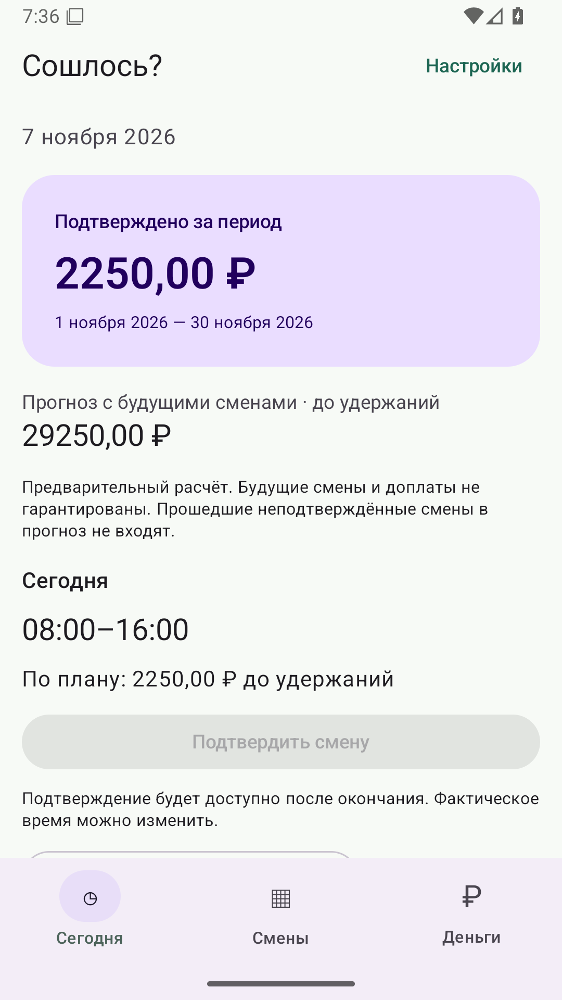
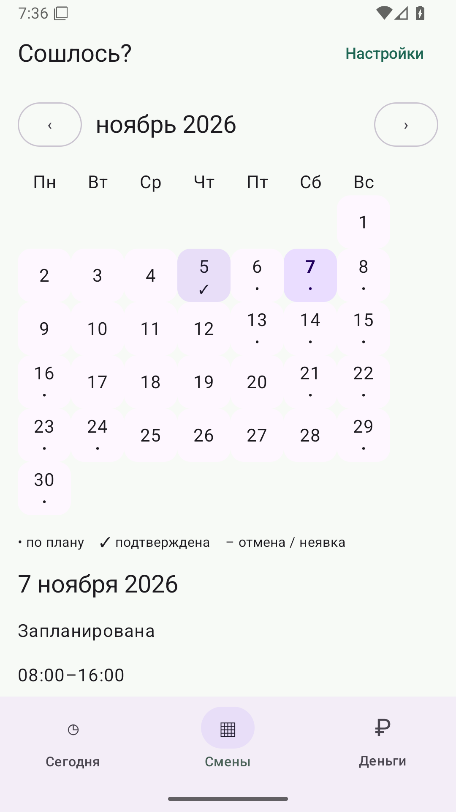
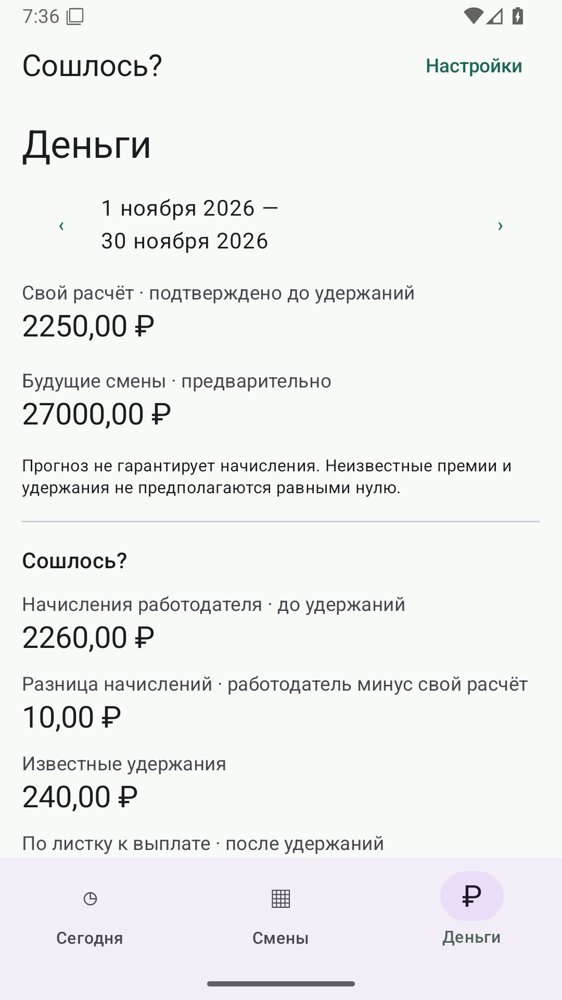

# Сошлось? — смены и зарплата

Работаешь ты. Деньги считаем мы.

[Скачать тестовую версию для Android 8 и новее](https://github.com/StanleyLl0yd/it-adds-up/releases)

Для тех, кто работает по сменам, получает за часы или за выход на работу и хочет понимать свои начисления. Задайте график и ставку, подтверждайте фактическую работу, сравнивайте свой расчёт с расчётным листком и поступлениями. Зарплата больше не должна быть сюрпризом в конце месяца.

## Что умеет приложение

- Графики 2/2, 3/3, сутки через трое, пятидневка и свой цикл.
- Календарь, смены вне графика, подтверждение, редактирование, отмена и неявка.
- Точный чек: оплаченные часы, ночные, неоплачиваемый перерыв, доплата, премия и корректировка. Исторические условия сохраняются вместе со сменой.
- Подтверждённый заработок отдельно от предварительного прогноза.
- Несколько выплат за период и сверка начислений с учётом известных удержаний.
- CSV, защищённая паролем резервная копия, восстановление и удаление локальных данных.
- Светлая, тёмная и системная темы, цвета обоев, отключаемые локальные напоминания.

Один рабочий профиль, одна смена на дату начала, рубли в интерфейсе. Ночное окно — 22:00–06:00. Месячный расчётный период начинается с выбранного дня 1–28. Приложение считает по введённым условиям, а не заменяет бухгалтерию: неизвестные налоги не предполагаются нулевыми, прогноз не гарантирует выплату, расхождение не доказывает нарушение.

## Как выглядит

Скриншоты локального учёта из 0.2.0-alpha.1 на Android-эмуляторе с искусственными данными. Актуальные кадры всех проверяемых сборок доступны в GitHub Actions.

  

## Данные и реклама

Без обязательного аккаунта и собственного сервера. Смены, ставки и выплаты хранятся на устройстве; основной учёт работает без интернета. Автоматическое системное резервное копирование выключено. Для переноса данных сохраните свою зашифрованную копию; пароль не восстанавливается. CSV не зашифрован.

Реклама появляется только после согласия в настройках. Это один баннер внизу «Сегодня». Alpha использует официальный тестовый блок Яндекса. Для production требуется отдельный ID и включение конфигурации. [Политика конфиденциальности](PRIVACY.md).

## Статус и установка

Ранняя alpha, ещё не опубликована в магазинах. Название предварительное. Production-ключей подписи и рекламных идентификаторов нет; версия не заявляется готовой к коммерческому выпуску.

Установочный debug APK доступен в разделе Assets у [выпусков](https://github.com/StanleyLl0yd/it-adds-up/releases), результаты проверок — в [GitHub Actions](https://github.com/StanleyLl0yd/it-adds-up/actions). Используйте искусственные записи для тестирования. Тестовые ключи подписи у разных CI-сборок могут отличаться. Перед переустановкой экспортируйте зашифрованную копию.

## Сборка и развитие

Kotlin, Compose, Material 3, Room и DataStore. Android 8.0+; для сборки нужны Java 21 и Android SDK 37.

```sh
./gradlew spotlessCheck testDebugUnitTest lintDebug assembleDebug
```

Условия публикации и production-подпись описаны в [инструкции выпуска](docs/RELEASE.md), ближайшие задачи — в [плане](ROADMAP.md). Сборки, отчёты и обсуждение изменений ведутся в GitHub.

Сообщайте об ошибках через [Issues](https://github.com/StanleyLl0yd/it-adds-up/issues), без реальных финансовых записей, токенов и паролей. Для приватных сообщений об уязвимостях включён GitHub private vulnerability reporting.

Публичный репозиторий не означает свободную лицензию. Условия распространения владелец пока не выбрал; до использования кода или внешнего вклада согласуйте права. [Подробнее для разработчиков](CONTRIBUTING.md).
